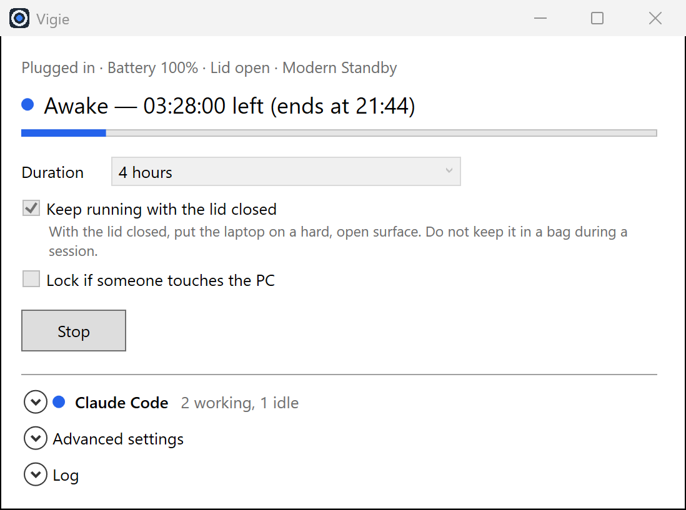

# Vigie

Vigie garde un ordinateur portable Windows 10 ou 11 éveillé pendant qu'une
tâche Claude Code s'exécute, y compris capot fermé. Lancez une longue tâche,
fermez le capot et partez : le portable ne se met pas en veille avant la fin de
la tâche. Chaque réglage d'alimentation que Vigie modifie est rétabli à la fin
de la session, même après un plantage ou un arrêt forcé.

> English version: [README.md](README.md). L'interface de Vigie est en anglais.

<p align="center">
  
</p>

## Ce que Vigie ne peut pas faire

- faire tourner Claude Code pendant une veille, une veille prolongée ou un arrêt ;
- empêcher le bouton d'alimentation, une batterie critique, un arrêt thermique ou
  un redémarrage de Windows Update ;
- contourner un micrologiciel qui force la veille à la fermeture du capot (rare) ;
- garder le réseau si le portable sort de la zone Wi-Fi ;
- empêcher la surchauffe dans un sac ou un espace fermé.

Si le PC a dormi malgré tout, Vigie le détecte et l'écrit en clair (heure, durée,
impact sur Claude Code) au lieu d'afficher « Running ».

## Prérequis

- Windows 10 version 1809 ou plus récent, ou Windows 11 (x64 ou ARM64).
- [Claude Code](https://code.claude.com/docs/en/setup) installé et connecté.
  Vigie cherche l'emplacement de l'installeur natif
  (`%USERPROFILE%\.local\bin\claude.exe`) et les exécutables du `PATH`.

## Installation

### Depuis une release

1. Téléchargez l'archive correspondant à votre architecture sur la
   [page des releases](https://github.com/bouh-d/vigie/releases).
2. Vérifiez son empreinte avec `SHA256SUMS.txt` :

   ```powershell
   Get-FileHash .\Vigie-win-x64.zip -Algorithm SHA256
   ```

3. Vigie n'est pas signée : Windows SmartScreen affiche un avertissement au
   premier lancement. Après avoir vérifié l'empreinte, choisissez
   **Informations complémentaires**, puis **Exécuter quand même**.
4. Décompressez l'archive et lancez `Vigie.exe`. Aucune installation ni droits
   administrateur ne sont nécessaires.

### Depuis les sources

```powershell
dotnet publish src/Vigie.App -c Release -r win-x64 --self-contained -p:PublishSingleFile=true -p:IncludeNativeLibrariesForSelfExtract=true
```

Remplacez `win-x64` par `win-arm64` pour l'ARM64. La compilation nécessite le
SDK .NET 10.

## Utilisation

La fenêtre montre ce dont une session a besoin. Les sections **Claude Code**,
**Advanced settings** et **Log** sont repliées en dessous.

1. Choisissez une durée : 15 minutes, 1, 2 ou 4 heures, une durée personnalisée,
   ou jusqu'à la fin de la tâche Claude Code.
2. Laissez **Keep running with the lid closed** coché.
3. Au besoin, ouvrez **Claude Code**, renseignez un dossier de projet et un
   prompt, choisissez **Autonomous task**, et lancez Claude Code depuis Vigie.
4. Appuyez sur **Start**. Fermez le capot et éloignez-vous.

La tâche autonome est le mode recommandé capot fermé : une session interactive
peut s'arrêter pour demander une autorisation, sans personne pour répondre.

La section **Claude Code** indique pour chaque processus s'il travaille
(*working*) ou attend (*idle*). Une session qui reste ouverte après sa tâche,
comme un onglet de l'application de bureau Claude, passe en attente après
environ deux minutes sans activité. Quand une session d'éveil suit une telle
tâche, la tâche compte comme terminée après 10 minutes sans activité.

**Advanced settings** regroupe les autres options. Vigie garde vos choix dans
`%LOCALAPPDATA%\Vigie\settings.json`.

Si votre portable se met en veille quand l'écran s'éteint malgré la session,
cochez **Modern Standby compatibility** dans **Advanced settings**. Vigie garde
alors aussi l'affichage actif tant que le capot est fermé, et verrouille toujours
la session à la fermeture du capot.

### Verrou d'activité

Cochez **Lock if someone touches the PC** pour un portable laissé ouvert
pendant une session. Après 3 secondes sans activité, le premier mouvement de
souris ou appui sur une touche verrouille le PC, et Claude Code continue. Dans
**Advanced settings**, vous pouvez choisir la mise en veille à la place : elle met
Claude Code en pause.

Ctrl + Alt + V désactive le verrou à votre retour et le réactive quand vous
repartez. Tapez-le avant de toucher à autre chose. Pour le changer, cliquez dans
le champ du raccourci dans **Advanced settings** et tapez la nouvelle
combinaison : deux touches parmi Ctrl, Alt et Maj (Shift), plus une lettre, un
chiffre ou F1 à F24.

### Reprise après la limite d'utilisation

Quand une tâche autonome lancée depuis Vigie s'arrête parce que votre limite
d'utilisation de Claude est atteinte, Vigie peut la relancer une fois la limite
réinitialisée. Cochez **Resume after the usage limit resets** dans
**Claude Code**. L'option est décochée par défaut, car le PC reste éveillé
jusqu'à la réinitialisation, ce qui consomme de la batterie.

Une minute après l'heure de réinitialisation annoncée par Claude Code, Vigie
reprend la session Claude Code de la tâche et lui demande de continuer. Vigie
n'attend que pendant la session d'éveil : choisissez donc
**Until the Claude Code task ends**, la tâche compte alors comme en cours
pendant l'attente, jusqu'au plafond. Vigie n'attend pas une limite qui se
réinitialise plus de 6 heures plus tard, comme une limite hebdomadaire, et
reprend une tâche au plus 3 fois. **Interrupt**, le lancement d'une autre tâche,
la fin de la session ou la fermeture de Vigie annulent l'attente.

## Ce que Vigie modifie, et comment elle le rétablit

Pendant une session, Vigie modifie au plus trois valeurs du mode d'alimentation,
note les valeurs d'origine dans `%LOCALAPPDATA%\Vigie\restore.json` avant toute
écriture, et les remet à l'identique à la fin :

- l'**action à la fermeture du capot**, sur secteur et sur batterie, passe à
  *Ne rien faire* (uniquement si **Keep running with the lid closed** est coché et
  qu'aucune stratégie de groupe ne l'impose) ;
- sur les machines Modern Standby, le **délai de mise en veille sur batterie**
  passe à *Jamais*, car Windows interrompt sinon les demandes de maintien en
  éveil cinq minutes après ce délai sur batterie.

Elle ne touche jamais au délai d'extinction de l'écran, au délai de veille sur
secteur, au bouton d'alimentation, à la batterie critique, à la veille prolongée
ni au mode d'alimentation actif.

Les réglages sont rétablis à la fin du minuteur, sur **Stop**, à la fermeture
de Vigie, à la fermeture de session Windows et sur exception non gérée. Si le
processus est tué, un processus témoin les rétablit, ou à défaut le lancement
suivant ou l'ouverture de session suivante.

Si une session a été interrompue sans rétablir les réglages, lancez :

```powershell
Vigie.exe --restore
```

En dernier recours, vous pouvez rétablir l'action du capot à la main avec
`powercfg`, à partir des valeurs d'origine de `restore.json` (action du capot :
0 ne rien faire, 1 veille, 2 veille prolongée, 3 arrêter ; délai de veille en
secondes, 0 = jamais) :

```powershell
powercfg /setacvalueindex SCHEME_CURRENT SUB_BUTTONS LIDACTION 1
powercfg /setdcvalueindex SCHEME_CURRENT SUB_BUTTONS LIDACTION 1
powercfg /setdcvalueindex SCHEME_CURRENT SUB_SLEEP STANDBYIDLE 1200
powercfg /setactive SCHEME_CURRENT
```

Certains portables masquent l'action du capot dans `powercfg /q`. Pour la lire,
`powercfg /qh SCHEME_CURRENT SUB_BUTTONS LIDACTION` affiche aussi les réglages
masqués.

## Désinstallation

1. Si une session a été interrompue, lancez `Vigie.exe --restore` une fois.
2. Supprimez le dossier de l'application et `%LOCALAPPDATA%\Vigie`.

Vigie n'installe aucun service, pilote ou tâche planifiée. La seule entrée de
démarrage utilisée est une valeur `RunOnce` sous `HKCU`, créée quand une session
modifie un réglage d'alimentation et supprimée une fois les réglages rétablis.

## Confidentialité

Vigie n'émet aucune requête réseau et n'a aucune télémétrie. Les journaux et les
sorties de Claude Code restent dans `%LOCALAPPDATA%\Vigie` et sont supprimés
après 14 jours. Ces sorties peuvent contenir du code et des secrets de votre
projet ; elles restent locales. Vigie ne lit ni ne stocke les identifiants de
Claude Code.

## Transparence

En dehors des tâches Claude Code visibles dans l'interface, le seul processus
sans fenêtre lancé par Vigie est le processus témoin de restauration, et la seule
entrée de démarrage est la valeur `RunOnce` décrite ci-dessus. Les deux existent
pour que les réglages soient rétablis si Vigie est tuée. Aucune obfuscation,
aucune compression d'exécutable, aucune injection de processus.

Le verrou d'activité lit seulement l'heure de la dernière saisie et si les
touches de modification de son raccourci sont enfoncées. Il n'installe aucun hook
clavier ou souris et n'enregistre aucune frappe. Son raccourci n'est enregistré
par `RegisterHotKey` que pendant une session.

Projet indépendant, non affilié à Anthropic. Claude et Claude Code sont des
marques d'Anthropic.

## Licence

[MIT](LICENSE).
